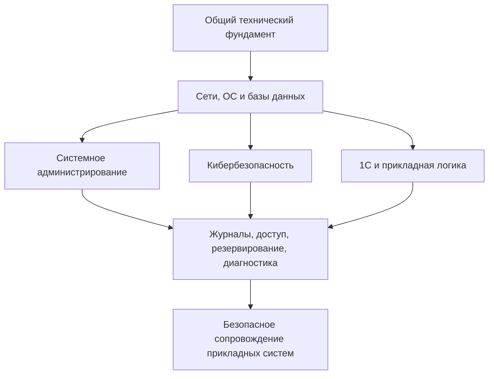

# Профессиональный профиль

> [!info] Профессиональная цель
> Развиваться как специалист по кибербезопасности с сильным сетевым и системно-административным фундаментом, подтверждая знания лабораторной практикой и стендами.

Учебный слой профиля построен по конспектам, заданиям, лабораторным и учебным артефактам. Подтверждённые рабочие задачи вынесены в отдельный [[00 — Дашборд профессионального опыта|раздел профессионального опыта]] и не смешиваются автоматически с учебными уровнями.

## Быстрая навигация

| Страница | Что показывает |
|---|---|
| [[01 — Инвентаризация курсов]] | Какие курсы активны, завершены или исключены из текущего фокуса |
| [[02 — Карта компетенций и матрица]] | Какие знания подтверждены, изучаются или требуют повторения |
| [[03 — Связь трёх направлений]] | Как 1С, ИБ и системное администрирование усиливают друг друга |
| [[04 — Закрепление и реестр доказательств]] | Что сделать за 15–60 минут и какие результаты уже существуют |
| [[05 — ViPNet — подготовка к экзамену]] | Какую роль ViPNet играет в текущей цели и насколько глубоко его изучать |
| [[06 — Ценность для работодателя]] | Честная формулировка профессиональной ценности |
| [[00 — Дашборд профессионального опыта]] | Реальные рабочие задачи, инструменты и практические компетенции |

## Текущий профиль

| Направление | Уже сформированная база | Сейчас развивается | Главный дефицит подтверждения |
|---|---|---|---|
| Кибербезопасность | Основы ИБ, учебные лабораторные и рабочие элементы безопасной эксплуатации | Новый курс ИБ, журналы, Sysmon, auditd, SIEM и ELK | Самостоятельные правила обнаружения и проверяемые лабораторные результаты |
| Сети | Компьютерные сети, СКС и рабочая диагностика | Завершение курса и домашний стенд | Практика с трафиком, маршрутизацией и сервисами |
| ViPNet и администрирование | Практика поддержки, ОС, мониторинга и базовые компоненты стенда | ViPNet, Proxmox, Windows Server, AD DS, DNS, DHCP и диагностика | Экзаменационные задачи и стендовые артефакты |

## Что уже изучено

- завершён курс DevOps с конспектами по Linux, Docker, хранилищам, базам данных, Bash, PowerShell, мониторингу, Git, IaC и облачным технологиям;
- завершены три вводных курса по информационной безопасности, включая основы ИБ, управление рисками, криптографию, аутентификацию, сетевую и прикладную безопасность;
- выполнены учебные практики по Linux, LVM, Docker и PostgreSQL;
- предыдущие активные курсы SQL, 1С и ИБ сохранены в архиве вместе с практиками и повторениями;
- ранее выполненные Python-задачи сохранены как справочные материалы и учебные доказательства, но курс исключён из активной нагрузки;
- сохранена история предыдущего плана и его учебных доказательств.

## Что изучается сейчас

- [[Введение в кибербезопасность — FREE — содержание|новый курс по кибербезопасности]];
- [[Компьютерные сети на примерах — содержание|компьютерные сети]];
- [[20 — Обучение/Активные курсы/VipNet - Подготовка к ДЭ/00 — Главная/00 — Навигация|ViPNet, стенд и подготовка к экзамену]];
- Windows Server, Proxmox и связанные серверные темы внутри стенда ViPNet.

## Состояние компетенций

В [[02 — Карта компетенций и матрица|карте компетенций]] выделена 31 компетенция:

| Состояние | Количество | Смысл |
|---|---:|---|
| Подтверждено материалами | 5 | Есть понятный артефакт, который можно проверить |
| Применял на учебном примере | 12 | Выполнено упражнение или лабораторная, но практический уровень не обобщается |
| Изучаю | 6 | Есть актуальные конспекты, тема развивается |
| Понимаю теоретически | 4 | Есть содержательная теория без отдельной практики |
| Нужно повторить | 4 | Материал архивный, фрагментарный или давно не закреплялся |

## Связь направлений

Практический смысл сочетания — понимать прикладную систему, инфраструктуру, в которой она работает, и защитные меры вокруг неё. Пока это направление формируется из отдельных учебных блоков; комплексная практика безопасного сопровождения 1С ещё не выполнена.

## Сильные стороны текущей базы

1. Связанный фундамент: сети, Linux, Windows-события, базы данных и основы ИБ.
2. Практика с кодом и запросами: SQL и BSL; Python-задачи сохранены как ранее выполненные артефакты.
3. Учебные лабораторные по SIEM, Sysmon, auditd, Autoruns, Docker, LVM и PostgreSQL.
4. Умение оформлять конспекты, повторение и выводы в проверяемую базу знаний.
5. Понимание границы между теорией, учебной практикой и реальным опытом.

## Что требует закрепления

> [!warning]
> - криптография и аутентификация из завершённого курса;
> - Git, IaC и облачная часть DevOps;
> - конфигурации Cisco, VLAN, маршрутизация, NAT и ACL;
> - ViPNet: 12 из 14 исходных заметок пусты, практики нет;
> - сопровождение и администрирование 1С пока не подтверждены отдельным кейсом.

## Ближайший реалистичный фокус

1. Последовательно проходить [[Введение в кибербезопасность — FREE — содержание]] и оформлять результаты 17 практических работ.
2. Закончить [[Компьютерные сети на примерах — содержание]] и собрать учебный сетевой стенд.
3. Продолжать [[20 — Обучение/Активные курсы/VipNet - Подготовка к ДЭ/00 — Главная/00 — Навигация|ViPNet]] и подготовку к экзамену на стенде.
4. Связывать Sysmon, auditd, журналы и ELK в единую практику обнаружения.
5. Не возвращать приостановленные курсы без отдельной задачи.

## Что можно показать работодателю

- ранее выполненные безопасные Python-задачи по обработке строк, журналов, JSON и XML;
- SQL-запросы от выборки и фильтрации до соединений;
- учебные BSL-задачи и систематизированное повторение 1С;
- разборы сетей, SIEM и веб-событий;
- DevOps-практику после проверки скриншотов и окружения;
- структуру базы знаний как пример технического документирования.

Подготовленная формулировка: [[06 — Ценность для работодателя]].

## Границы оценки

- Наличие конспекта не означает практического владения.
- Завершённый курс подтверждает обучение, но не заменяет проверяемый результат.
- Рабочие инструкции, DTEK Core, CyberWhale и китайский язык в профиль не включены.
- Материалы со скриншотами, адресами, журналами и сертификатом проверяются перед публикацией.

## Навигация

- [[20 — Обучение/00 — Профессиональный профиль специалиста/README|О разделе]]
- [[Обучение]]
- [[Главная]]
