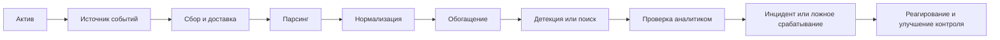
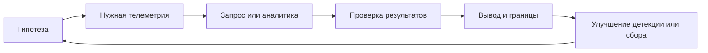

# День 3 — «Специалист по противодействию кибератакам»

> [!info] Фактическая точка
> В хранилище представлены уровень 1 «Инфраструктура» и уровень 1.1 «Обнаружение злоумышленника на периметре». Последняя документированная практика — [[20 — Обучение/Активные курсы/Специалист по противодействию кибератакам/2. Уровень 1.1. Обнаружение злоумышленника на периметре. Сервисы/Практика/2.8. Практика. Анализ логов веб-приложений|2.8. Практика. Анализ логов веб-приложений]]. Фактическое завершение уровня 1.1 и следующая тема на платформе требуют уточнения.

Основной источник: [[Повторение курса по противодействию кибератакам]]. Эта страница задаёт рабочий маршрут, практические результаты и проверку понимания, не копируя полный обзор курса.

## Правила дня

1. Начинай каждый блок без конспекта и сначала записывай то, что помнишь.
2. Работай только с синтетическими или заранее обезличенными событиями.
3. Не переноси в заметки реальные адреса, домены, учётные записи, секреты и журналы организации.
4. Каждое предположение отделяй от подтверждённого факта.
5. После теста переноси ошибки в [[03 — Журнал пробелов]].
6. Если блок прерван, продолжай с последнего незакрытого чекбокса.

---

## Блок 1. Архитектура мониторинга и путь события в SIEM

**Время:** 40–45 минут.  
**Цель:** восстановить путь от источника телеметрии до проверяемого события безопасности.

### Активное воспоминание

Ответь без конспекта:

1. Чем Log Management отличается от SIEM?
2. Какие задачи решают EDR, NTA, IDS/IPS, WAF, TIP и SOAR?
3. Какие этапы проходит событие от источника до аналитика?
4. Чем парсинг отличается от нормализации и обогащения?
5. Как понять, что источник перестал присылать события?

### Простое объяснение

Система мониторинга начинается не с красивого дашборда, а с надёжной телеметрии. Источник создаёт событие, агент или коллектор доставляет его, система разбирает поля, приводит данные к общей схеме и добавляет контекст. После этого правило или аналитик связывает событие со сценарием атаки. Если часть цепочки не работает, отсутствие оповещения ещё не означает отсутствие атаки.

### Основные понятия

| Понятие | Рабочий смысл |
|---|---|
| Источник | Система, приложение или средство защиты, создающее события |
| Сборщик | Компонент, принимающий и передающий события |
| Парсинг | Выделение полей из исходной записи |
| Нормализация | Приведение разных источников к общей модели полей |
| Обогащение | Добавление контекста об активе, пользователе, адресе или индикаторе |
| Корреляция | Связывание нескольких событий по времени, сущности и сценарию |
| Детекция | Логика, выделяющая подозрительное поведение |
| Инцидент | Подтверждённое или обоснованно подозреваемое нарушение, требующее обработки |

Подробное восстановление: [[Повторение курса по противодействию кибератакам#1. Архитектура средств защиты и мониторинга]], [[Повторение курса по противодействию кибератакам#2. От источника до инцидента в SIEM]] и [[Повторение курса по противодействию кибератакам#3. Источники событий инфраструктуры]].

### Логическая схема

### Безопасная практика

Составь паспорт одного учебного источника событий.

| Поле | Ответ |
|---|---|
| Источник | |
| Какие действия наблюдает | |
| Ключевые поля | |
| Способ доставки | |
| Как контролируется потеря событий | |
| Возможная детекция | |
| Возможное ложное срабатывание | |
| Кто и как проверяет результат | |

Допустимые источники: Sysmon, auditd, журнал веб-сервера, WAF или синтетический журнал аутентификации.

### Вопросы на понимание

1. Почему установка Elasticsearch и Kibana сама по себе ещё не создаёт SIEM?
2. Почему качество времени и идентификаторов важно для расследования?
3. Как отличить отсутствие подозрительных событий от потери телеметрии?
4. Какие поля нужны, чтобы связать события пользователя, процесса и сетевого соединения?

### Мини-тест

- [ ] Могу объяснить путь события от источника до инцидента.
- [ ] Различаю парсинг, нормализацию, обогащение и корреляцию.
- [ ] Могу назвать ограничения не менее четырёх классов защитных решений.
- [ ] Составил паспорт источника и предусмотрел контроль потери событий.

---

## Блок 2. Веб-, сетевые события и проверка срабатывания

**Время:** 40–45 минут.  
**Цель:** научиться связывать события WAF, веб-сервера и сетевых средств защиты в одну временную линию.

### Активное воспоминание

1. Какие поля нужны для анализа HTTP-запроса?
2. Чем WAF отличается от NGFW, IDS и IPS?
3. Что меняется при inline и out-of-band размещении?
4. Как различить попытку атаки и успешное воздействие?
5. Какие причины ложного срабатывания нужно проверить до блокировки?

### Простое объяснение

Одно срабатывание показывает только наблюдение конкретного средства защиты. WAF видит HTTP-контекст, NGFW — сетевую сессию и приложение, IDS/IPS — признаки в трафике, а веб-сервер и ОС показывают результат обработки запроса. Аналитик строит временную линию и ищет подтверждение на соседних уровнях, прежде чем объявить инцидент.

### Основные поля

| Источник | Поля, которые особенно полезны |
|---|---|
| WAF | время, клиент, host, URI, метод, правило, действие, идентификатор транзакции |
| Веб-сервер | время, адрес, URI, статус, размер ответа, user-agent, referrer |
| NGFW | источник, назначение, порты, приложение, пользователь, действие, объём |
| IDS/IPS | время, сигнатура, поток, протокол, приоритет, действие |
| ОС | пользователь, процесс, командная строка, файл, сетевое соединение, результат |

Подробное восстановление: [[Повторение курса по противодействию кибератакам#6. Анализ журналов веб-приложения]] и [[Повторение курса по противодействию кибератакам#8. WAF, NGFW и IDS/IPS]].

### Безопасная практика

Разбери синтетический сценарий:

> С одного учебного адреса за короткое время поступило много запросов к разным путям. WAF отметил часть запросов как traversal, веб-сервер вернул несколько кодов `404`, один `403` и один `200`. На сервере в то же время появился новый дочерний процесс веб-службы.

Заполни карточку:

| Вопрос | Ответ |
|---|---|
| Что известно точно | |
| Что является гипотезой | |
| Какие события связать | |
| Какие поля использовать для связи | |
| Что подтвердит успешное воздействие | |
| Возможное ложное объяснение | |
| Безопасное первое действие | |
| Какие данные сохранить | |

### Самостоятельное объяснение

Объясни своими словами цепочку:

`запрос → срабатывание WAF → запись веб-сервера → процесс ОС → исходящее соединение → решение аналитика`.

### Мини-тест

- [ ] Различаю контекст WAF, NGFW, IDS и IPS.
- [ ] Не считаю сигнатурное срабатывание доказательством компрометации.
- [ ] Могу построить временную линию по нескольким источникам.
- [ ] Всегда формулирую хотя бы одну ложноположительную гипотезу.
- [ ] Отделяю сохранение доказательств от активного блокирования.

---

## Блок 3. Linux: повышение привилегий, закрепление и реагирование

**Время:** 40–45 минут.  
**Цель:** восстановить признаки посткомпрометационных действий и порядок безопасной проверки.

### Активное воспоминание

1. Какие журналы Linux помогают расследовать действия пользователя и процесса?
2. Какие признаки могут указывать на повышение привилегий?
3. Где злоумышленник может закрепиться после доступа к системе?
4. Почему обнаружение нового SSH-ключа требует проверки владельца и контекста?
5. Почему после root-компрометации недостаточно удалить найденный файл?

### Простое объяснение

После первоначального доступа злоумышленник стремится получить больше прав, сохранить доступ и скрыть действия. Защитник проверяет не отдельный файл, а цепочку: кто вошёл, какой процесс запустился, какие права получил, что изменил и куда подключался. При компрометации максимальных привилегий локальной системе нельзя полностью доверять: восстановление должно опираться на доверенные образы, резервные копии и внешнюю телеметрию.

### Что проверять

| Область | Примеры признаков |
|---|---|
| Аутентификация | необычное время входа, новый источник, ошибки и успешный вход после перебора |
| Привилегии | `sudo`, изменение групп, SUID/SGID, необычные действия root |
| Закрепление | SSH-ключи, cron, systemd, shell-профили, новые пользователи |
| Процессы | неожиданный дочерний процесс сервиса, запуск из временного каталога |
| Файлы | новый исполняемый файл, изменение конфигурации или веб-каталога |
| Сеть | новое исходящее соединение, необычный порт или назначение |

Подробное восстановление: [[Повторение курса по противодействию кибератакам#7. Повышение привилегий и закрепление в Linux]] и [[Повторение курса по противодействию кибератакам#10. Противодействие на периметре]].

### Безопасная практика

Составь план проверки учебного события: «в `authorized_keys` появился неизвестный ключ».

1. Зафиксируй время, путь, владельца и права файла.
2. Определи, какое событие или процесс мог изменить файл.
3. Сопоставь входы, `sudo`, процессы и сетевые соединения.
4. Проверь, есть ли другие механизмы закрепления.
5. Определи, какие данные сохранить до изменений.
6. Опиши условия изоляции узла и смены секретов.
7. Объясни, когда требуется восстановление из доверенного источника.

### Связь с рабочей ситуацией

Сравни обработку события с обычной диагностикой сервера:

- симптом;
- временная линия;
- проверяемые гипотезы;
- минимально рискованное действие;
- контроль результата;
- документирование и эскалация.

Не используй реальные сведения рабочей инфраструктуры.

### Мини-тест

- [ ] Могу назвать источники телеметрии Linux.
- [ ] Различаю повышение привилегий и закрепление.
- [ ] Проверяю связанные действия до удаления артефакта.
- [ ] Понимаю, почему root-компрометация меняет границы доверия.
- [ ] Могу составить безопасный порядок реагирования.

---

## Блок 4. Threat Hunting, карточка детекции и итоговый инцидент

**Время:** 40–45 минут.  
**Цель:** связать гипотезу, телеметрию, поиск, проверку и улучшение защиты.

### Активное воспоминание

1. Чем Threat Hunting отличается от обработки готового оповещения?
2. Из каких частей состоит проверяемая hunt-гипотеза?
3. Чем IOC отличается от поведенческого признака?
4. Как документировать отрицательный результат поиска?
5. Что должна содержать карточка правила обнаружения?

### Простое объяснение

Threat Hunting начинается с обоснованного предположения, которое можно проверить доступной телеметрией. Аналитик определяет наблюдаемое поведение, выполняет поиск, проверяет альтернативные объяснения и фиксирует результат. Даже если атака не найдена, поиск полезен, когда подтверждены охват данных, границы проверки и обнаруженные пробелы телеметрии.

### Цикл hunting

Подробное восстановление: [[Повторение курса по противодействию кибератакам#9. Threat Hunting]], [[Повторение курса по противодействию кибератакам#11. Сквозной сценарий обнаружения]] и [[Повторение курса по противодействию кибератакам#12. Практический минимум после перерыва]].

### Безопасная практика

Составь карточку детекции для синтетического сценария: веб-служба запускает оболочку или сетевую утилиту после подозрительного HTTP-запроса.

| Поле карточки | Содержание |
|---|---|
| Цель обнаружения | |
| Гипотеза | |
| Источники данных | |
| Ключевые поля | |
| Логика поиска | |
| Условия подтверждения | |
| Возможные ложные срабатывания | |
| Приоритет | |
| Первые действия аналитика | |
| Проверка качества правила | |
| Что улучшить после проверки | |

### Итоговый сквозной сценарий

Объясни без конспекта:

1. какой актив защищается;
2. какое действие нарушителя рассматривается;
3. где возникает телеметрия;
4. как событие попадает в систему анализа;
5. какая логика выделяет подозрительное поведение;
6. чем подтверждается или опровергается гипотеза;
7. какие данные сохраняются;
8. какое действие безопасно выполнить первым;
9. как проверить результат;
10. как улучшить архитектуру или правило после инцидента.

### Мини-тест

- [ ] Формулирую проверяемую hunt-гипотезу.
- [ ] Различаю IOC и поведенческий признак.
- [ ] Указываю охват и ограничения отрицательного результата.
- [ ] Составил карточку детекции с ложноположительной гипотезой.
- [ ] Могу связать атаку, телеметрию, обнаружение, реагирование и улучшение защиты.

---

## Итоговый тест дня

Ответь без конспекта:

1. Какие этапы проходит событие от источника до аналитика?
2. Как контролировать потерю телеметрии?
3. Чем WAF, NGFW, IDS и IPS отличаются по контексту и возможностям?
4. Как связать HTTP-запрос с процессом на сервере?
5. Что нужно проверить после появления неизвестного SSH-ключа?
6. Почему при root-компрометации локальным данным нельзя полностью доверять?
7. Чем готовое оповещение отличается от hunt-гипотезы?
8. Какие ограничения есть у хэша, IP-адреса и домена как IOC?
9. Что должна содержать карточка детекции?
10. Как отличить подтверждённый инцидент от предположения?

## Критерии завершения дня 3

- [ ] Могу нарисовать путь события от источника до инцидента.
- [ ] Различаю основные классы средств защиты и их ограничения.
- [ ] Могу построить временную линию по веб-, сетевым и системным событиям.
- [ ] Отличаю попытку атаки от подтверждённого воздействия.
- [ ] Могу разобрать признаки повышения привилегий и закрепления Linux.
- [ ] Умею сформулировать hunt-гипотезу и карточку детекции.
- [ ] Выполнил четыре практических результата.
- [ ] Прошёл итоговый тест и перенёс ошибки в [[03 — Журнал пробелов]].
- [ ] Понимаю, что продолжать на уровне 1.1 и что требует уточнения на платформе.

## Практические результаты дня

1. Паспорт источника событий.
2. Карточка разбора веб- и сетевого срабатывания.
3. План проверки закрепления Linux.
4. Карточка детекции и сквозной сценарий инцидента.

## Точка продолжения обычного обучения

Вернись к [[Специалист по противодействию кибератакам — содержание]] и уточни на платформе:

1. завершён ли уровень 1.1;
2. проверены ли результаты [[20 — Обучение/Активные курсы/Специалист по противодействию кибератакам/2. Уровень 1.1. Обнаружение злоумышленника на периметре. Сервисы/Практика/2.8. Практика. Анализ логов веб-приложений|практики 2.8]];
3. какая тема идёт следующей;
4. какие пробелы из журнала мешают продолжению.

Не отмечай уровень завершённым только по наличию локальных конспектов.

## Как использовать ChatGPT

1. `Проведи устный опрос по пути события в SIEM. Задавай по одному вопросу и проси привести пример.`
2. `Дай синтетические события WAF, веб-сервера и Linux и попроси меня построить временную линию.`
3. `Проверь мою карточку детекции: отдельно оцени телеметрию, логику, ложные срабатывания и действия аналитика.`
4. `Дай безопасный сценарий повышения привилегий Linux и проси выбирать следующий источник проверки.`
5. `Помоги превратить расплывчатое предположение в проверяемую hunt-гипотезу, не раскрывая готовый ответ сразу.`
6. `Устрой короткое техническое собеседование по SIEM, WAF, IDS/IPS, Threat Hunting и реагированию.`

## Навигация

- [[00 — Дашборд двухдневного повторения|Дашборд восстановления знаний]]
- [[03 — Журнал пробелов]]
- [[Повторение курса по противодействию кибератакам]]
- [[Специалист по противодействию кибератакам — содержание]]
- [[Обучение]]
