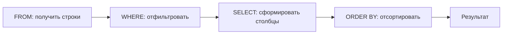

# День 4 — SQL

> [!info] Фактическая точка
> В хранилище представлены темы от подключения к базе данных до соединения таблиц и 19 практических задач. Последний документированный раздел — `JOIN`. Полный объём исходного курса и следующая тема на платформе требуют уточнения.

Основной источник: [[Подробное повторение SQL]]. Эта страница задаёт рабочий маршрут и самостоятельную практику, не копируя полный разбор курса.

## Правила дня

1. Сначала напиши запрос самостоятельно, затем сверяйся с конспектом.
2. Используй только учебную базу или синтетические таблицы.
3. Перед выполнением объясняй, какие строки и столбцы ожидаешь получить.
4. Для каждого запроса проверяй результат на граничных случаях и `NULL`.
5. Не подключайся к рабочей базе и не используй реальные персональные данные.
6. После теста переноси ошибки в [[03 — Журнал пробелов]].

Для практики используй общую схему:

```sql
users(id, first_name, last_name, email, score, is_active, created_at)
tasks(id, title, difficulty)
solutions(id, user_id, task_id, language, sent_at, is_correct)
```

---

## Блок 1. `SELECT`, сортировка, `WHERE` и логика

**Время:** 40–45 минут.  
**Цель:** уверенно выбирать нужные данные и точно задавать условия фильтрации.

### Активное воспоминание

Ответь без конспекта:

1. В каком порядке логически выполняются `FROM`, `WHERE`, `SELECT` и `ORDER BY`?
2. Почему порядок строк нельзя считать гарантированным без `ORDER BY`?
3. Почему `SELECT *` нежелателен в прикладном запросе?
4. Как SQL вычисляет выражение с `AND`, `OR` и `NOT`?
5. Почему `column = NULL` не работает как обычное сравнение?

### Простое объяснение

Запрос сначала определяет источник строк, затем отбрасывает строки по условию, формирует результат и только после этого сортирует его. Хороший запрос явно показывает, какие данные нужны, почему строка попадает в результат и в каком порядке результат должен быть показан.

### Основные понятия

| Конструкция | Назначение |
|---|---|
| `SELECT` | Выбрать столбцы или вычисляемые выражения |
| `FROM` | Указать источник данных |
| `WHERE` | Оставить строки, для которых условие истинно |
| `AS` | Дать понятное имя столбцу или таблице |
| `ORDER BY` | Явно определить порядок результата |
| `IS NULL` | Проверить отсутствие значения |
| `IS NOT NULL` | Проверить наличие значения |

Подробное восстановление: [[Подробное повторение SQL#1. База данных и безопасное подключение]], [[Подробное повторение SQL#2. `SELECT`, `FROM`, алиасы и сортировка]] и [[Подробное повторение SQL#3. `WHERE`, сравнения и логика]].

### Логическая схема



### Безопасная практика

Напиши без подсказки три запроса:

1. Вывести `id`, имя, e-mail и score активных пользователей, отсортировав по score по убыванию и `id` по возрастанию.
2. Найти пользователей без фамилии или со score больше 100.
3. Найти активных пользователей, у которых e-mail заполнен и выполняется одно из условий: score не меньше 80 или дата регистрации позже выбранной учебной даты.

Перед запуском для каждого запроса запиши:

- ожидаемые столбцы;
- какие строки должны пройти фильтр;
- где нужны скобки;
- как должен обрабатываться `NULL`;
- чем проверить правильность результата.

### Вопросы на понимание

1. Что изменится, если убрать скобки из условия с `AND` и `OR`?
2. Чем `NULL` отличается от пустой строки и нуля?
3. Почему сортировка только по неуникальному score может давать нестабильный порядок?
4. Когда вычисление в `WHERE` ухудшает понятность запроса?

### Мини-тест

- [ ] Выбираю только необходимые столбцы.
- [ ] Всегда задаю сортировку, когда порядок важен.
- [ ] Правильно использую `IS NULL` и `IS NOT NULL`.
- [ ] Расставляю скобки в сложных условиях.
- [ ] Могу объяснить результат до выполнения запроса.

---

## Блок 2. Текст, шаблоны, `NULL` и `CASE`

**Время:** 40–45 минут.  
**Цель:** преобразовывать текст и безопасно строить вычисляемые категории.

### Активное воспоминание

1. Чем `LIKE` отличается от `ILIKE` в PostgreSQL?
2. Что означают шаблоны `%` и `_`?
3. Чем `concat`, `concat_ws` и оператор `||` отличаются при `NULL`?
4. Для чего используются `COALESCE` и `NULLIF`?
5. Как SQL выбирает ветвь выражения `CASE`?

### Простое объяснение

Текстовые функции позволяют привести данные к нужному виду, извлечь часть строки и проверить шаблон. При этом отсутствие значения нужно обрабатывать явно: `NULL` может изменить результат конкатенации и сравнения. `CASE` превращает условия в вычисляемое значение, но порядок ветвей важен — срабатывает первое истинное условие.

### Основные конструкции

| Конструкция | Назначение |
|---|---|
| `lower`, `upper` | Изменить регистр |
| `length` | Получить длину строки |
| `trim` | Убрать крайние пробелы |
| `substring` | Извлечь часть строки |
| `LIKE`, `ILIKE` | Проверить строку по шаблону |
| `concat_ws` | Объединить части через разделитель, пропуская `NULL` |
| `COALESCE` | Взять первое значение, которое не равно `NULL` |
| `NULLIF` | Вернуть `NULL`, если два выражения равны |
| `CASE` | Вычислить значение по нескольким условиям |

Подробное восстановление: [[Подробное повторение SQL#4. Текстовые функции и шаблоны]] и [[Подробное повторение SQL#5. Объединение строк, `NULL`, `CASE`]].

### Безопасная практика

Напиши запросы:

1. Вывести нормализованный e-mail в нижнем регистре и его длину.
2. Извлечь домен из e-mail и найти пользователей с точным учебным доменом `example.test`.
3. Сформировать отображаемое имя из имени и фамилии так, чтобы отсутствие фамилии не уничтожало результат.
4. Разделить пользователей на группы `низкий`, `средний`, `высокий` по score с явно заданными границами.

### Проверка граничных случаев

Проверь запросы на строках, где:

- фамилия отсутствует;
- e-mail равен `NULL`;
- e-mail содержит смешанный регистр;
- score находится точно на границе диапазона;
- имя содержит крайние пробелы.

### Самостоятельное объяснение

Объясни разницу между:

- `email LIKE '%example.test'` и точным выделением домена;
- `first_name || ' ' || last_name` и `concat_ws(' ', first_name, last_name)`;
- `COALESCE(score, 0)` и реальным значением score, равным нулю;
- двумя порядками ветвей `CASE` от узкого условия к широкому и наоборот.

### Мини-тест

- [ ] Различаю `LIKE` и `ILIKE`.
- [ ] Не путаю отсутствие значения с пустой строкой.
- [ ] Выбираю подходящую конкатенацию с учётом `NULL`.
- [ ] Могу написать многоуровневый `CASE` без пересечения ветвей.
- [ ] Проверяю текстовые преобразования на граничных случаях.

---

## Блок 3. Даты, интервалы, типы и `DISTINCT`

**Время:** 40–45 минут.  
**Цель:** правильно фильтровать временные данные и понимать влияние типов на результат.

### Активное воспоминание

1. Чем дата отличается от timestamp?
2. Для чего используются `date_trunc`, `extract` и `to_char`?
3. Почему диапазон времени удобно задавать полуоткрытым интервалом?
4. Когда требуется явное приведение типа?
5. К каким столбцам применяется `DISTINCT`?

### Простое объяснение

Дата отвечает на вопрос «какой день», а timestamp хранит конкретный момент. Для полного периода безопаснее задавать нижнюю границу включительно, а верхнюю исключительно: это не зависит от точности хранения времени и не теряет события в конце дня. Тип данных определяет допустимые операции, точность вычисления и способ сравнения.

### Основные функции

| Конструкция | Результат |
|---|---|
| `date_trunc('month', value)` | Начало месяца |
| `extract(year from value)` | Числовая часть даты или интервала |
| `to_char(value, format)` | Текстовое представление |
| `value + interval '1 day'` | Сдвиг времени |
| `value::type` или `CAST` | Явное приведение типа |
| `DISTINCT` | Уникальные комбинации выбранных выражений |

Подробное восстановление: [[Подробное повторение SQL#6. Даты, время и интервалы PostgreSQL]] и [[Подробное повторение SQL#7. Приведение типов и `DISTINCT`]].

### Безопасная практика

Напиши запросы:

1. Вывести начало месяца регистрации пользователя.
2. Найти регистрации за выбранный календарный месяц полуоткрытым интервалом.
3. Вывести дату в форматах `YYYY-MM` и `DD Mon YYYY`.
4. Найти записи, попавшие в первые 45 суток после учебной даты.
5. Получить уникальные сочетания языка и сложности задачи.

### Задача на объяснение

Сравни два условия:

```sql
created_at::date = DATE '2026-10-22'
```

```sql
created_at >= TIMESTAMP '2026-10-22 00:00:00'
AND created_at < TIMESTAMP '2026-10-23 00:00:00'
```

Объясни:

- почему результаты могут совпасть;
- чем различается обработка столбца;
- какой вариант лучше выражает временной диапазон;
- почему функции над столбцом могут влиять на использование индекса.

### Мини-тест

- [ ] Различаю форматирование значения и изменение самого типа.
- [ ] Умею округлять дату до начала периода.
- [ ] Фильтрую timestamp полуоткрытым интервалом.
- [ ] Явно привожу тип, когда от этого зависит вычисление.
- [ ] Понимаю, что `DISTINCT` применяется к комбинации выбранных столбцов.

---

## Блок 4. `JOIN` и самостоятельный набор запросов

**Время:** 45–50 минут.  
**Цель:** соединять связанные таблицы без потери нужных строк и случайного размножения результата.

### Активное воспоминание

1. Чем `INNER JOIN` отличается от `LEFT JOIN`?
2. Что происходит со строкой левой таблицы, если пары справа нет?
3. Почему условие по правой таблице в `WHERE` может изменить смысл `LEFT JOIN`?
4. Откуда появляются дубли при связи один-ко-многим?
5. Как найти строки, для которых связанной записи нет?

### Простое объяснение

`JOIN` связывает строки по условию. Перед запросом нужно понимать кардинальность: одна строка пользователя может соответствовать многим решениям. Поэтому несколько строк после соединения не всегда являются ошибочными дублями. Тип соединения определяет, какие строки сохраняются, а место дополнительного условия — участвует ли оно в поиске пары или отбрасывает уже полученный результат.

### Виды соединений

| Соединение | Какие строки сохраняются |
|---|---|
| `INNER JOIN` | Только строки с парой с обеих сторон |
| `LEFT JOIN` | Все строки слева и найденные пары справа |
| `RIGHT JOIN` | Все строки справа и найденные пары слева |
| `FULL JOIN` | Все строки обеих таблиц |

Подробное восстановление: [[Подробное повторение SQL#8. Соединение таблиц]], [[Подробное повторение SQL#9. Все практические задачи курса — исправленные решения]] и [[Подробное повторение SQL#10. Самостоятельный тренажёр]].

### Безопасная практика: пять связанных запросов

Напиши без просмотра решений:

1. Активные пользователи с заполненным e-mail, отсортированные по score.
2. Пользователи, зарегистрированные в выбранном месяце, с вычисляемой группой score.
3. Все отправленные решения с именем пользователя и названием задачи.
4. Все пользователи, включая тех, у кого нет решений.
5. Пользователи без единого решения.

Для каждого запроса зафиксируй:

| Проверка | Ответ |
|---|---|
| Какой результат нужен | |
| Главная таблица | |
| Связи и кардинальность | |
| Почему выбран этот тип `JOIN` | |
| Условия в `ON` | |
| Условия в `WHERE` | |
| Ожидаемое число строк или способ проверки | |
| Найденная ошибка и исправление | |

### Практика проверки результата

Для одного запроса вручную создай маленький набор из:

- двух пользователей;
- трёх задач;
- нескольких решений одного пользователя;
- пользователя без решений;
- задачи без решений.

До выполнения запроса нарисуй ожидаемый результат. Затем сравни его с фактическим и объясни каждую строку.

### Мини-тест

- [ ] Различаю `INNER`, `LEFT`, `RIGHT` и `FULL JOIN`.
- [ ] Понимаю разницу условий в `ON` и `WHERE`.
- [ ] Умею найти строки без пары.
- [ ] Предсказываю размножение строк при связи один-ко-многим.
- [ ] Могу соединить три таблицы и проверить результат вручную.

---

## Итоговый тест дня

Ответь без конспекта и приведи короткий SQL-пример:

1. Каков логический порядок выполнения изученных частей запроса?
2. Как правильно проверить `NULL`?
3. Почему скобки важны в условии с `AND` и `OR`?
4. Чем `LIKE` отличается от `ILIKE`?
5. Как безопасно объединить имя и необязательную фамилию?
6. Почему порядок ветвей `CASE` влияет на результат?
7. Как выбрать все события календарного дня из timestamp?
8. Чем форматирование даты отличается от приведения типа?
9. К чему применяется `DISTINCT`?
10. Почему `LEFT JOIN` с условием справа в `WHERE` может вести себя как `INNER JOIN`?
11. Как найти пользователей без решений?
12. Как проверить, что соединение не создало ошибочные повторы?

## Критерии завершения дня 4

- [ ] Пишу `SELECT`, фильтрацию и сортировку без подсказки.
- [ ] Правильно обрабатываю `NULL` и сложные логические условия.
- [ ] Использую текстовые функции и `CASE` на учебных данных.
- [ ] Работаю с датами и полуоткрытыми временными диапазонами.
- [ ] Понимаю приведение типов и область действия `DISTINCT`.
- [ ] Различаю виды `JOIN`, условия `ON` и `WHERE`.
- [ ] Выполнил пять связанных запросов и сохранил проверку результата.
- [ ] Прошёл итоговый тест и перенёс ошибки в [[03 — Журнал пробелов]].
- [ ] Понимаю, какая тема идёт следующей на платформе или что нужно уточнить.

## Практические результаты дня

1. Три проверенных запроса на выборку и фильтрацию.
2. Четыре запроса на текст, `NULL` и `CASE` с граничными случаями.
3. Пять запросов на даты, типы и уникальные комбинации.
4. Пять связанных запросов с объяснением `JOIN` и ручной проверкой результата.

## Точка продолжения обычного обучения

После повторения вернись к [[SQL — содержание]] и:

1. сохрани пять самостоятельных запросов как единый проверяемый результат;
2. отметь ошибки, которые повторились без подсказки;
3. уточни следующую тему и полный объём курса на платформе;
4. только после контрольной точки решай вопрос о передаче параллельного учебного слота курсу 1С.

Наличие готовых решений в конспекте не означает, что запрос освоен: критерием служит самостоятельное решение и проверка результата.

## Как использовать ChatGPT

1. `Дай небольшую схему таблиц и попроси меня написать SELECT с фильтрацией. Не показывай решение до моей попытки.`
2. `Проверь мой SQL-запрос: сначала опиши фактическую логику, затем укажи ошибку и дай один граничный пример.`
3. `Дай задачу на NULL, AND и OR, в которой неправильные скобки меняют результат.`
4. `Дай задачу на полуоткрытый диапазон timestamp и проверь моё объяснение.`
5. `Устрой пошаговую проверку LEFT JOIN: попроси сначала предсказать строки результата.`
6. `Проведи короткое техническое собеседование по SELECT, CASE, датам и JOIN.`

## Навигация

- [[00 — Дашборд двухдневного повторения|Дашборд восстановления знаний]]
- [[03 — Журнал пробелов]]
- [[Подробное повторение SQL]]
- [[SQL — содержание]]
- [[Обучение]]
