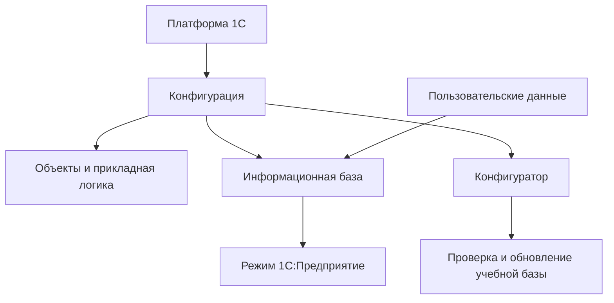

# День 5 — 1С-программирование

> [!info] Фактическая точка
> В хранилище представлены введение в платформу, работа с информационной базой и основы встроенного языка: переменные, типы, условия, циклы и структуры. Последняя документированная тема — структуры 1С. Следующая тема и полный объём исходного курса требуют уточнения.

Основной источник: [[Повторение введения и основ синтаксиса]]. Эта страница задаёт рабочий маршрут и самостоятельную практику, не копируя полный конспект курса.

## Правила дня

1. Все действия выполняй только в учебной информационной базе.
2. До изменения конфигурации создай проверяемую резервную копию учебной базы.
3. Сначала пиши решение самостоятельно, затем сверяйся с конспектом.
4. Для каждого фрагмента кода объясняй входные данные, результат и граничные случаи.
5. Не переноси в учебную базу реальные рабочие данные, реквизиты и пользовательские сведения.
6. После теста переноси ошибки в [[03 — Журнал пробелов]].

---

## Блок 1. Платформа, конфигурация и безопасная учебная база

**Время:** 35–40 минут.  
**Цель:** восстановить устройство среды 1С и безопасный порядок работы с учебной базой.

### Активное воспоминание

Ответь без конспекта:

1. Чем платформа отличается от конфигурации?
2. Чем информационная база отличается от конфигурации и пользовательских данных?
3. Для чего нужны режимы «1С:Предприятие» и «Конфигуратор»?
4. Чем файл `.dt` отличается от `.cf`?
5. Что нужно проверить до и после загрузки учебной базы?

### Простое объяснение

Платформа 1С исполняет прикладное решение. Конфигурация описывает структуру и логику приложения, а информационная база содержит конфигурацию и данные конкретной среды. Пользователь работает с прикладными функциями в режиме «1С:Предприятие», разработчик меняет конфигурацию и код в Конфигураторе. Даже в учебной среде изменение или восстановление базы начинается с понимания, что именно сохраняется и куда будет загружено.

### Основные понятия

| Понятие | Рабочий смысл |
|---|---|
| Платформа | Среда исполнения и разработки приложений 1С |
| Конфигурация | Описание объектов, интерфейса и прикладной логики |
| Информационная база | Конфигурация и данные конкретной среды |
| «1С:Предприятие» | Пользовательский режим выполнения прикладных операций |
| Конфигуратор | Режим разработки, настройки и администрирования |
| `.dt` | Выгрузка информационной базы вместе с данными |
| `.cf` | Файл конфигурации без пользовательских данных базы |

Подробное восстановление: [[Повторение введения и основ синтаксиса#1. Платформа, конфигурация и информационная база]].

### Логическая схема

### Безопасная практика

Составь чек-лист подготовки учебной базы:

| Шаг | Что проверить | Результат |
|---:|---|---|
| 1 | База учебная, в ней нет рабочих данных | [ ] |
| 2 | Понятно, где хранится база и какая версия платформы используется | [ ] |
| 3 | Создана резервная копия `.dt` | [ ] |
| 4 | Выбрано понятное имя и место хранения копии | [ ] |
| 5 | После изменения конфигурация проверена | [ ] |
| 6 | База запускается в режиме «1С:Предприятие» | [ ] |
| 7 | Результат изменения проверен на учебных данных | [ ] |

Запиши своими словами, когда нужен `.dt`, а когда достаточно `.cf`. Не выполняй восстановление поверх единственной копии базы.

### Вопросы на понимание

1. Почему наличие `.cf` не означает наличие пользовательских данных?
2. Что может произойти при загрузке `.dt` не в ту информационную базу?
3. Почему успешное открытие Конфигуратора ещё не доказывает работоспособность приложения?
4. Какие проверки относятся к разработке, а какие — к сопровождению базы?

### Мини-тест

- [ ] Различаю платформу, конфигурацию, базу и данные.
- [ ] Понимаю назначение двух режимов работы.
- [ ] Объясняю разницу между `.dt` и `.cf`.
- [ ] Составил безопасный чек-лист учебной базы.
- [ ] Не переношу рабочие данные в учебную среду.

---

## Блок 2. Базовый синтаксис, переменные, типы и выражения

**Время:** 40–45 минут.  
**Цель:** самостоятельно написать небольшой код и объяснить тип каждого значения.

### Активное воспоминание

1. Где может размещаться программный код 1С?
2. Как вывести сообщение пользователю?
3. Какие базовые типы данных уже изучены?
4. Как выполняются присваивание, арифметика и объединение строк?
5. Чем значение даты отличается от её текстового представления?

### Простое объяснение

Программа получает значения, сохраняет их в переменных, выполняет выражения и выдаёт результат. Тип значения определяет допустимые операции: числа складываются, строки соединяются, булевы значения участвуют в условиях, даты можно сравнивать и изменять функциями работы со временем. Форматирование создаёт представление для пользователя, но не должно незаметно подменять исходный тип.

### Основные элементы

| Элемент | Назначение |
|---|---|
| Переменная | Именованное место для значения |
| Строка | Текстовые данные |
| Число | Целые и дробные вычисления |
| Булево | Значения `Истина` и `Ложь` |
| Дата | Дата и при необходимости время |
| `Сообщить()` | Вывести учебное сообщение |
| `Формат()` | Получить строковое представление значения |
| Комментарий | Объяснить причину или смысл решения |

Подробное восстановление: [[Повторение введения и основ синтаксиса#2. Первая программа и базовый синтаксис]] и [[Повторение введения и основ синтаксиса#3. Основные типы данных и выражения]].

### Безопасная практика

Напиши процедуру для учебного товара. Она должна:

1. сохранить название, цену, количество и признак наличия;
2. рассчитать сумму;
3. сформировать понятное сообщение;
4. вывести дату проверки в удобном формате;
5. не использовать реальные товары и цены.

Пример ожидаемого смысла результата:

> Учебный товар «Кабель»: 3 шт., сумма 750,00; проверено 22.10.2026.

Перед запуском заполни таблицу:

| Переменная | Тип | Начальное значение | Как используется |
|---|---|---|---|
| | | | |
| | | | |
| | | | |
| | | | |

### Проверка граничных случаев

Проверь поведение при:

- количестве `0`;
- отрицательной цене, которая должна считаться ошибкой входных данных;
- пустом названии;
- дробной сумме;
- значении наличия `Ложь`.

### Самостоятельное объяснение

Объясни:

- почему осмысленное имя переменной полезнее `Переменная1`;
- чем число отличается от строки, содержащей цифры;
- почему результат `Формат()` обычно является строкой;
- когда комментарий помогает понять решение, а когда только повторяет код.

### Мини-тест

- [ ] Могу создать переменные и объяснить их типы.
- [ ] Выполняю арифметические операции и объединяю строки.
- [ ] Различаю дату и её строковое представление.
- [ ] Использую понятные имена переменных.
- [ ] Проверил код на граничных значениях.

---

## Блок 3. Условия и циклы

**Время:** 40–45 минут.  
**Цель:** управлять выполнением программы и не создавать бесконечные или логически неверные ветви.

### Активное воспоминание

1. Как устроены `Если`, `ИначеЕсли`, `Иначе` и `КонецЕсли`?
2. Как работают `И`, `ИЛИ` и `НЕ`?
3. Почему порядок условий от частного к общему может быть важен?
4. Чем циклы `Пока`, `Для` и `Для каждого` отличаются по назначению?
5. Какие ошибки приводят к бесконечному циклу?

### Простое объяснение

Условие выбирает одну ветвь программы по данным. Цикл повторяет действие, пока сохраняется условие, изменяется счётчик или остаются элементы коллекции. Перед запуском нужно уметь объяснить, как программа войдёт в ветвь или цикл, что изменится внутри и почему выполнение завершится.

### Основные конструкции

| Конструкция | Когда использовать |
|---|---|
| `Если ... Тогда` | Проверить одно условие |
| `ИначеЕсли` | Проверить следующую альтернативу |
| `Иначе` | Обработать все оставшиеся случаи |
| `И`, `ИЛИ`, `НЕ` | Объединить или изменить логические условия |
| `Пока` | Повторять, пока условие истинно |
| `Для` | Повторить по числовому диапазону |
| `Для каждого` | Обработать элементы коллекции |

Подробное восстановление: [[Повторение введения и основ синтаксиса#4. Условный оператор и логические выражения]] и [[Повторение введения и основ синтаксиса#5. Циклы]].

### Безопасная практика

Выполни четыре небольшие задачи:

1. По учебному остатку вывести `Нет в наличии`, `Мало`, `Достаточно` или `Избыточный остаток`.
2. Вывести числа от 1 до 10 циклом `Для`, а затем в обратном порядке.
3. Посчитать сумму чисел от 1 до заданного положительного числа.
4. Перебрать учебный список значений и вывести только положительные.

Для каждой задачи запиши:

| Проверка | Ответ |
|---|---|
| Входные данные | |
| Условия и границы | |
| Что изменяется на каждом шаге | |
| Почему цикл завершится | |
| Ожидаемый результат | |

### Задача на объяснение

До запуска вручную проследи три итерации одного цикла. Запиши значение счётчика, условие продолжения и накопленный результат. Если используешь `Пока`, отдельно укажи строку, которая изменяет условие завершения.

### Типичные ошибки

- пересекающиеся ветви `ИначеЕсли` расположены в неправильном порядке;
- сложное условие записано без скобок и читается неоднозначно;
- счётчик цикла `Пока` не изменяется;
- граница цикла включается или исключается не так, как ожидалось;
- вложенный цикл используется там, где достаточно одного прохода;
- тернарный оператор скрывает сложную бизнес-логику.

### Мини-тест

- [ ] Пишу полную конструкцию условия без подсказки.
- [ ] Правильно использую `И`, `ИЛИ`, `НЕ` и скобки.
- [ ] Выбираю подходящий вид цикла.
- [ ] Могу доказать, что цикл завершится.
- [ ] Проверяю границы диапазонов и порядок условий.

---

## Блок 4. Структуры и итоговая учебная задача

**Время:** 45–50 минут.  
**Цель:** объединить изученные конструкции в небольшой самостоятельный результат.

### Активное воспоминание

1. Для чего нужна структура 1С?
2. Какие требования предъявляются к ключу структуры?
3. Как создать структуру, добавить элементы и получить значение?
4. Чем обычная структура отличается от фиксированной?
5. Как перебрать элементы структуры циклом `Для каждого`?

### Простое объяснение

Структура объединяет связанные значения под понятными ключами. Это удобно для небольшого набора параметров учебного объекта или результата вычисления. Структура не заменяет все объекты конфигурации: она хранит значения в памяти и помогает организовать данные внутри конкретной задачи.

### Основные действия

| Действие | Смысл |
|---|---|
| Создать структуру | Подготовить набор именованных значений |
| `Вставить` | Добавить или заменить значение по ключу |
| Получить по ключу | Прочитать конкретное значение |
| `Свойство` | Безопасно проверить наличие ключа и получить значение |
| Перебрать | Обработать все пары «ключ — значение» |
| Зафиксировать | Запретить изменение состава структуры |

Подробное восстановление: [[Повторение введения и основ синтаксиса#6. Структуры]], [[Повторение введения и основ синтаксиса#7. Как темы соединяются в одной задаче]] и [[Повторение введения и основ синтаксиса#8. Практический минимум после перерыва]].

### Итоговая безопасная практика

Создай небольшую учебную процедуру «Проверка учебного товара».

Исходные данные:

- название;
- цена;
- количество;
- минимальный допустимый остаток;
- дата проверки;
- признак активности.

Требования:

1. Сохрани исходные значения в структуре.
2. Проверь корректность цены и количества.
3. Рассчитай сумму остатка.
4. Определи состояние: `Неактивен`, `Нет в наличии`, `Нужно пополнить`, `Достаточно`.
5. Сформируй итоговую структуру с результатом проверки.
6. Перебери итоговую структуру и выведи понятные сообщения.
7. Проверь минимум четыре граничных сценария.

### План решения до кода

| Элемент | Решение |
|---|---|
| Входные значения и типы | |
| Проверки входных данных | |
| Порядок условий | |
| Вычисляемые значения | |
| Ключи итоговой структуры | |
| Что выводится пользователю | |
| Граничные сценарии | |

### Критерии результата

- код выполняется в учебной базе;
- переменные имеют понятные имена;
- условия не пересекаются неожиданным образом;
- цикл имеет понятное завершение;
- структура содержит только связанные данные;
- результат проверен на нулевом, малом, достаточном и некорректном остатке;
- рядом записан собственный вывод: что получилось и какая ошибка была исправлена.

### Мини-тест

- [ ] Создаю и заполняю структуру без подсказки.
- [ ] Проверяю существование нужного ключа.
- [ ] Перебираю структуру циклом `Для каждого`.
- [ ] Связал типы, условия, циклы и структуру в одной задаче.
- [ ] Проверил результат на четырёх сценариях.

---

## Итоговый тест дня

Ответь без конспекта:

1. Чем платформа отличается от конфигурации и информационной базы?
2. Для чего используются режимы «1С:Предприятие» и «Конфигуратор»?
3. Чем `.dt` отличается от `.cf`?
4. Какие базовые типы данных изучены?
5. Чем дата отличается от её результата `Формат()`?
6. Как выбирается ветвь `Если — ИначеЕсли — Иначе`?
7. Почему порядок условий может изменить результат?
8. Чем `Пока`, `Для` и `Для каждого` отличаются?
9. Как доказать, что цикл завершится?
10. Для чего нужна структура?
11. Как безопасно проверить наличие ключа структуры?
12. Какие этапы прошла итоговая учебная задача от входных данных до проверки результата?

## Критерии завершения дня 5

- [ ] Различаю платформу, конфигурацию, информационную базу и данные.
- [ ] Понимаю назначение режимов и разницу между `.dt` и `.cf`.
- [ ] Пишу базовый код с переменными, типами и выражениями.
- [ ] Использую условия и логические операторы без подсказки.
- [ ] Выбираю подходящий цикл и объясняю его завершение.
- [ ] Создаю, читаю и перебираю структуру.
- [ ] Выполнил итоговую учебную задачу и проверил граничные случаи.
- [ ] Прошёл итоговый тест и перенёс ошибки в [[03 — Журнал пробелов]].
- [ ] Понимаю, какая тема идёт следующей на платформе или что требуется уточнить.

## Практические результаты дня

1. Чек-лист безопасной работы с учебной базой.
2. Процедура с переменными, типами и форматированием.
3. Четыре задачи на условия и циклы.
4. Итоговая процедура со структурой и проверкой учебного товара.

## Точка продолжения обычного обучения

После повторения вернись к [[1С для начинающих — содержание]] и:

1. сохрани итоговую задачу как проверяемый учебный результат;
2. отметь повторившиеся ошибки в синтаксисе и логике;
3. уточни следующую тему и полный объём курса на платформе;
4. отделяй программирование BSL от подтверждённого рабочего сопровождения 1С.

Наличие конспекта или рабочего опыта сопровождения не означает освоение разработки: подтверждением служит самостоятельно написанный, запущенный и проверенный учебный код.

## Как использовать ChatGPT

1. `Дай небольшую задачу на типы данных 1С и проверь моё решение после попытки.`
2. `Проверь условие на BSL: сначала перечисли граничные случаи, затем укажи логическую ошибку.`
3. `Дай цикл 1С с ошибкой завершения и попроси меня найти её без готового ответа.`
4. `Попроси меня вручную проследить значения переменных на трёх итерациях цикла.`
5. `Дай задачу на структуру 1С и потребуй сначала описать ключи и типы значений.`
6. `Проведи короткое техническое собеседование по платформе, DT/CF, типам, условиям, циклам и структурам.`

## Навигация

- [[00 — Дашборд двухдневного повторения|Дашборд восстановления знаний]]
- [[03 — Журнал пробелов]]
- [[Повторение введения и основ синтаксиса]]
- [[1С для начинающих — содержание]]
- [[Обучение]]
