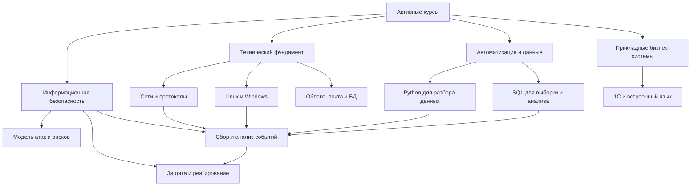

# Дашборд активного обучения

> [!info] Назначение
> Дашборд показывает, какие профессиональные направления формируются активными курсами, чем они подтверждаются и как усиливают друг друга. Это не расписание и не оценка профессионального опыта.

## Быстрая навигация

| Страница | Для чего нужна |
|---|---|
| [[01 — Карта компетенций]] | Детальный перечень компетенций и уровней подтверждения |
| [[02 — Матрица Курсы × Компетенции]] | Вклад каждого курса в профессиональные области |
| [[03 — Дорожная карта развития специалиста]] | Уровни формирования общего профиля |
| [[04 — Синергия активных курсов]] | Практические связи между дисциплинами |
| [[05 — Ценность для работодателя]] | Публично-безопасная формулировка ценности обучения |
| [[06 — Реестр учебных доказательств]] | Конспекты, запросы, скрипты и лабораторные |
| [[07 — Зоны дальнейшего усиления]] | Пробелы внутри текущего обучения |

## Подтверждённые активные курсы

| Активный курс | Почему включён | Что формирует | Текущее подтверждение |
|---|---|---|---|
| [[Специалист по кибербезопасности — содержание]] | Папка активного курса, `status: active`, 36 содержательных заметок и практика | Модель атак, сегментация, Linux, Windows, Sysmon, auditd, защита конечных точек | Практика и учебные лабораторные; часть материалов требует очистки |
| [[Специалист по противодействию кибератакам — содержание]] | Папка активного курса, `status: active`, 20 заметок и анализ веб-логов | SIEM, источники событий, WAF/NGFW/IDS/IPS, Threat Hunting, реагирование | Лабораторная SIEM и практические запросы по логам |
| [[Компьютерные сети на примерах — содержание]] | Находится в активных курсах, `status: active`, 45 исходных заметок | OSI, Ethernet, TCP/IP, IPv4, подсети, маршрутизация, сетевые сервисы | Подробные конспекты и задания для самопроверки; практический стенд не оформлен |
| [[Python для кибербезопасности — содержание]] | Папка активного курса, `status: active`, 18 выполненных задач | Базовый Python, строки, условия, ввод, JSON/XML, разбор журналов | Код решений в 18 учебных задачах |
| [[SQL — содержание]] | Папка активного курса, `status: active`, 31 заметка и 19 практических задач | Выборка, фильтрация, строки, даты, `NULL`, `CASE`, соединения | SQL-запросы и исправленный полный разбор практики |
| [[1С для начинающих — содержание]] | Папка активного курса, `status: active`, 13 заметок и задачи | Платформа 1С, информационная база, BSL, условия, циклы, структуры | Решения учебных задач и систематизированное повторение |

## Требует уточнения

Дополнительных курсов с неопределённым статусом не найдено. [[Кейсы SkillFactory — содержание]] учитываются как связанная практика курса по кибербезопасности, а не как отдельный активный курс.

## Формирующийся профессиональный профиль

## Основные направления развития

| Направление | Что реально развивается | Основные курсы |
|---|---|---|
| Информационная безопасность | Риски, этапы атак, поверхность атаки, сегментация, hardening | [[Специалист по кибербезопасности — содержание]] |
| Обнаружение и мониторинг | Источники событий, SIEM, Sysmon, auditd, веб- и сетевые логи | Оба курса по кибербезопасности |
| Сети | OSI, Ethernet, TCP/IP, IPv4, подсети и маршрутизация | [[Компьютерные сети на примерах — содержание]] |
| Защита инфраструктуры | Linux, GPO, облачные роли, почта, БД, WAF, IDS/IPS | Оба курса по кибербезопасности |
| Автоматизация | Небольшие Python-скрипты для строк и структурированных данных | [[Python для кибербезопасности — содержание]] |
| Анализ данных | SQL-фильтры, преобразования, даты и связи таблиц | [[SQL — содержание]] |
| Бизнес-системы | Основы 1С, BSL и логика прикладных сценариев | [[1С для начинающих — содержание]] |

## Ключевые технологии и инструменты

| Область | Технологии и инструменты, подтверждённые материалами |
|---|---|
| Сети | Ethernet, TCP/IP, IPv4, CIDR, NAT, DNS, DHCP, ARP, ICMP |
| ОС и аудит | Linux, DAC, ACL, SELinux, OpenSCAP, auditd, iptables, Windows Event Log |
| Мониторинг | Elastic Stack, Kibana, Fleet, Sysmon, osquery, SIEM, SOAR/IRP |
| Периметр | WAF, ModSecurity, NGFW, Snort, Suricata, IDS/IPS, fail2ban |
| Анализ угроз | MITRE ATT&CK, OWASP, IOC, YARA, Autoruns, Process Explorer |
| Автоматизация | Python, `json`, `xml.etree.ElementTree`, обработка строк и stdin |
| Данные | PostgreSQL, SQL `SELECT`, `WHERE`, функции, даты, `JOIN` |
| Прикладные системы | 1С:Предприятие, Конфигуратор, BSL, DT/CF, структуры |

> [!note] Граница утверждений
> Наличие темы в конспекте означает «изучаю». Практика подтверждается только там, где есть выполненная задача, лабораторная, запрос, скрипт или оформленный разбор.

## Уровень подтверждения компетенций

| Уровень | Количество компетенций | Интерпретация |
|---|---:|---|
| Ознакомление | 1 | Есть обзор темы, но нет отдельной практики |
| Изучение | 7 | Есть содержательные конспекты и связи |
| Практика | 8 | Есть упражнения или лабораторные действия |
| Подтверждено материалами | 6 | Есть понятный артефакт, который можно показать |
| Требует проверки | 0 | Неопределённые навыки не включались как компетенции |

Подробности: [[01 — Карта компетенций]].

## Практические результаты

- 18 Python-задач с кодом по базовому синтаксису и парсингу данных;
- 19 SQL-задач и [[Подробное повторение SQL|полный исправленный разбор запросов]];
- задачи BSL по типам, условиям, циклам и структурам;
- лабораторные заметки по Autoruns, Sysmon и auditd;
- развёртывание учебного Elastic Stack и подключение источников;
- практика анализа веб-логов в Kibana/KQL;
- учебные разборы OWASP, сетевой сегментации и разведки;
- цельные повторения по сетям и трём крупным курсам.

## Межкурсовые связи

- сети дают контекст для анализа WAF, IDS/IPS и сетевых событий;
- Linux и Windows создают телеметрию для SIEM;
- курс по кибербезопасности объясняет поведение нарушителя, курс по противодействию — обнаружение и реагирование;
- Python формирует основу автоматизации разбора текстов, JSON и XML;
- SQL формирует основу анализа табличных данных и связей;
- 1С развивает понимание прикладной логики и бизнес-данных, но связь с безопасностью 1С пока не подтверждена практикой.

Подробнее: [[04 — Синергия активных курсов]].

## Что уже можно показать работодателю

> [!success]
> - систематизированную базу активного обучения;
> - безопасные Python-задачи по разбору логов и JSON/XML;
> - SQL-запросы от фильтрации до соединений;
> - практику анализа веб-событий в Kibana;
> - конспекты и лабораторные по Sysmon, auditd и Autoruns после очистки чувствительных деталей;
> - собственные обзорные материалы по сетям, SIEM и защитной аналитике.

Полный перечень: [[06 — Реестр учебных доказательств]].

## Что пока находится в развитии

> [!warning]
> - самостоятельные detection rules и оформленные результаты Threat Hunting;
> - законченная практическая схема сегментации;
> - сетевые лаборатории с сохранёнными конфигурациями и проверками;
> - объединение Python и SQL с реальным обезличенным набором событий;
> - демонстрационное приложение 1С;
> - публичная очистка части лабораторных материалов.

Подробнее: [[07 — Зоны дальнейшего усиления]].

## Следующий уровень профессионального профиля

Следующий слой должен отдельно описать работу, техническую поддержку, колледж и проекты, а затем связывать их с этой картой. На текущем этапе никаких выводов из этих источников не сделано.

## Навигация

- [[20 — Обучение/Активные курсы/00 — Карта профессионального развития/README|О разделе]]
- [[Обучение|Назад к активным курсам]]
- [[Главная]]
