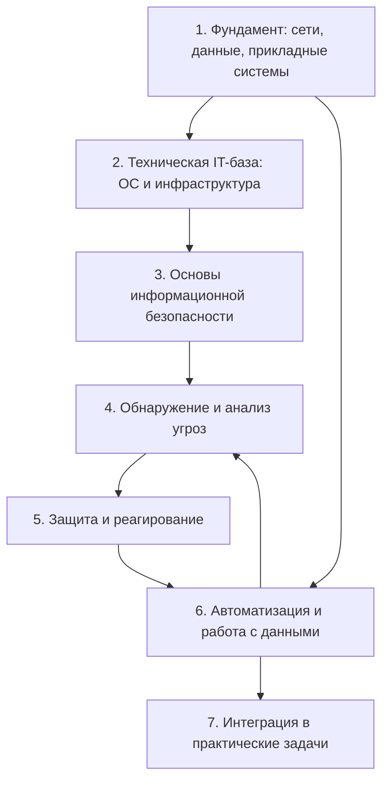

# Дорожная карта развития специалиста

Это смысловая карта формирования профессионального профиля. Она не задаёт даты, дедлайны и порядок уроков.

## 1. Фундамент: сети, данные и прикладные системы

**Курсы:** [[Компьютерные сети на примерах — содержание]], [[SQL — содержание]], [[1С для начинающих — содержание]].

**Формируется:** понимание передачи данных, адресации, реляционных таблиц, информационной базы и прикладной логики.

**Связи:** сеть объясняет путь данных; SQL — их выборку и отношения; 1С — использование данных в бизнес-системе.

**Практические результаты:** SQL-запросы, BSL-задачи, расчёты подсетей и вопросы для самопроверки.

**Не хватает:** оформленной сетевой лаборатории и законченного мини-приложения 1С.

## 2. Техническая IT-база: ОС и инфраструктура

**Курсы:** оба курса по кибербезопасности и сетевой курс.

**Формируется:** Linux, права доступа, OpenSCAP, auditd, GPO, облачные роли, почта, БД и сетевые сервисы.

**Связи:** протоколы и ОС создают события; инфраструктурные настройки определяют поверхность атаки.

**Практические результаты:** OpenSCAP-разбор, auditd, Autoruns, Sysmon и лабораторный Elastic Stack.

**Не хватает:** единого безопасного baseline с проверкой до/после и планом отката.

## 3. Основы информационной безопасности

**Курс:** [[Специалист по кибербезопасности — содержание]].

**Формируется:** риски, модель атаки, OSINT, первоначальный доступ, закрепление, сегментация и защита конечных точек.

**Связи:** сети и ОС превращаются из общих IT-знаний в объекты защиты.

**Практические результаты:** OWASP-лаборатория, Autoruns, Sysmon, аудит ОС, разведка и сегментация.

**Не хватает:** завершённого отчёта по сегментации и единых шаблонов лабораторных результатов.

## 4. Обнаружение и анализ угроз

**Курсы:** [[Специалист по противодействию кибератакам — содержание]] и [[Специалист по кибербезопасности — содержание]].

**Формируется:** источники событий, SIEM, веб-/Linux-/сетевые логи, IOC, YARA и Threat Hunting.

**Связи:** поведение нарушителя сопоставляется с наблюдаемыми процессами, соединениями и журналами.

**Практические результаты:** KQL-анализ веб-логов, Sysmon, auditd и примеры YARA.

**Не хватает:** самостоятельного hunt-отчёта и нескольких протестированных detection rules.

## 5. Защита и реагирование

**Курсы:** оба курса по кибербезопасности.

**Формируется:** WAF, IDS/IPS, DDoS-защита, hardening, сдерживание и восстановление.

**Связи:** обнаружение становится полезным только при наличии проверяемого действия и контроля результата.

**Практические результаты:** сценарии защиты периметра, разбор root-компрометации, honeypot и сегментация.

**Не хватает:** оформленной настольной тренировки инцидента с ролями, временем и итоговым отчётом.

## 6. Автоматизация и работа с данными

**Курсы:** [[Python для кибербезопасности — содержание]] и [[SQL — содержание]].

**Формируется:** обработка строк, JSON/XML, фильтрация, даты, условия и связи таблиц.

**Связи:** Python подходит для подготовки и нормализации данных, SQL — для запросов и аналитики по структурам данных.

**Практические результаты:** 18 Python-задач и 19 SQL-задач.

**Не хватает:** общего проекта на обезличенном наборе событий с входными данными, тестами и отчётом.

## 7. Интеграция знаний в практические задачи

**Курсы:** все активные курсы, но только через подтверждённые пересечения.

**Формируется:** способность проследить путь от инфраструктуры и события до анализа, решения и документации.

**Уже существует:** связанные повторения, карты курсов, лабораторные заметки и [[06 — Реестр учебных доказательств]].

**Не хватает:** нескольких законченных демонстрационных кейсов формата «задача → данные → анализ → решение → проверка → вывод».

## Навигация

- [[00 — Дашборд активного обучения]]
- [[04 — Синергия активных курсов]]
- [[06 — Реестр учебных доказательств]]
- [[07 — Зоны дальнейшего усиления]]
- [[Обучение|Назад к активным курсам]]
