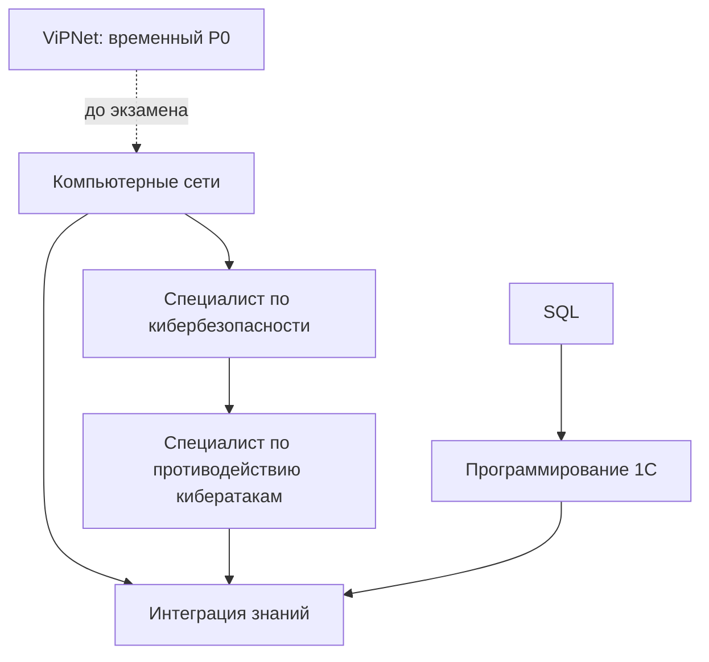

# Дорожная карта развития специалиста

Это смысловая карта формирования профессионального профиля. Она не задаёт даты, дедлайны и порядок уроков.

## 1. Основной трек — компьютерные сети

**Курс:** [[Компьютерные сети на примерах — содержание]].

**Формируется:** понимание передачи данных, адресации, сетевых сервисов, маршрутизации и диагностики.

**Связи:** сети являются основой для сегментации, анализа событий, защиты периметра и подготовки по ViPNet.

**Практический результат:** схема пути пакета с точками диагностики и ответы по главе 7.

**Переход дальше:** не требуется завершать весь курс; достаточно уверенно объяснить OSI/TCP-IP, IPv4/CIDR, шлюз, DNS, DHCP, NAT, TCP/UDP и самостоятельно разобрать один сетевой сценарий.

## 2. Основной трек — специалист по кибербезопасности

**Курс:** [[Специалист по кибербезопасности — содержание]].

**Формируется:** риски, модель атаки, OSINT, сегментация, Linux/Windows, телеметрия и защитные меры.

**Связи:** сетевой фундамент превращается в понимание защищаемых активов, поверхности атаки и источников событий.

**Практический результат:** кейс «действие нарушителя → телеметрия → обнаружение → защитная мера».

**Переход дальше:** один сквозной кейс выполнен и объяснён без пошаговой подсказки.

## 3. Основной трек — противодействие кибератакам

**Курс:** [[Специалист по противодействию кибератакам — содержание]].

**Формируется:** источники событий, SIEM, KQL, WAF/IDS/IPS, Threat Hunting, анализ и реагирование.

**Связи:** модель атаки и телеметрия из предыдущего курса превращаются в гипотезу обнаружения и действие аналитика.

**Практический результат:** один обезличенный анализ учебного инцидента с запросом, временной линией и разбором ложного срабатывания.

**Переход дальше:** запрос и вывод воспроизводимы, ограничения объяснены.

## 4. Прикладной трек — SQL

**Курс:** [[SQL — содержание]].

**Формируется:** выборка, фильтрация, `NULL`, `CASE`, даты, преобразования и соединения таблиц.

**Связи:** SQL поддерживает отчёты, анализ данных, будущие задачи ИБ и понимание запросного мышления перед 1С.

**Практический результат:** пять самостоятельно написанных запросов на общей учебной схеме.

**Граница:** план не включает специализацию администратора СУБД. Для перехода к 1С достаточно уверенно применять `SELECT`, `WHERE`, `NULL`, `CASE` и `JOIN`.

## 5. Прикладной трек — программирование 1С

**Курс:** [[1С для начинающих — содержание]].

**Формируется:** платформа 1С, информационная база, типы, условия, циклы, структуры и базовая логика BSL.

**Связи:** общий SQL помогает понимать данные и условия выборки, но язык запросов 1С начинается там, где появляются метаданные, регистры, виртуальные таблицы и синтаксис платформы.

**Практический результат:** небольшая учебная обработка или процедура с проверкой ввода, циклом, структурой и выводом.

**Граница:** прямой SQL к рабочей базе 1С и администрирование кластера не входят в подтверждённый план.

## Отдельно: временный экзаменационный трек ViPNet

**Материал:** [[04 — Стратегия подготовки по ViPNet|ViPNet — подготовка к экзамену]].

**Роль:** отдельный `P0` только до экзамена, без включения в постоянную последовательность пяти курсов.

**Без лицензии:** архитектура, роли компонентов, сетевые зависимости, алгоритмы диагностики и подготовка чек-листа.

**Только на официальном стенде:** установка нужной версии, создание объектов, ключевые операции и действия, требуемые программой экзамена.

**Контрольная точка:** после экзамена выполнить **«Пересмотреть после экзамена»** и убрать `P0`.

## 6. Интеграция знаний в практические задачи

**Курсы:** все активные курсы, но только через подтверждённые пересечения.

**Формируется:** способность проследить путь от инфраструктуры и события до анализа, решения и документации.

**Уже существует:** связанные повторения, карты курсов, лабораторные заметки и [[06 — Реестр учебных доказательств]].

**Не хватает:** нескольких законченных демонстрационных кейсов формата «задача → данные → анализ → решение → проверка → вывод».

## Навигация

- [[00 — Дашборд активного обучения]]
- [[04 — Синергия активных курсов]]
- [[06 — Реестр учебных доказательств]]
- [[07 — Зоны дальнейшего усиления]]
- [[Обучение|Назад к активным курсам]]
