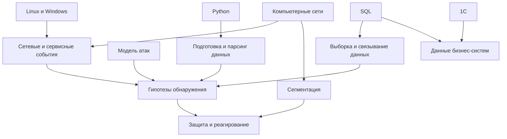

# Синергия активных курсов

Страница показывает только связи, которые подтверждаются содержанием активных курсов.

## Сети → события → обнаружение

**Объединяются:** OSI, TCP/IP, адреса, порты и маршрутизация из [[Компьютерные сети на примерах — содержание]] с WAF, IDS/IPS и SIEM из [[Специалист по противодействию кибератакам — содержание]].

**Задача на пересечении:** понять, какой узел и сервис участвовали в сетевом событии, где наблюдать трафик и как связать его с приложением.

**Возможный артефакт:** разбор сетевого инцидента с адресами, портами, протоколом, временной линией и защитным действием.

**Существующие связи:** [[Стек TCP-IP]], [[Анализ журналов]], [[Повторение курса по противодействию кибератакам]].

## Linux → auditd → SIEM

**Объединяются:** hardening, права и аудит Linux из [[Специалист по кибербезопасности — содержание]] с конвейером событий SIEM из курса по противодействию.

**Задача на пересечении:** обнаружить изменение критичного файла, запуск привилегированной команды или закрепление и передать событие в централизованное хранилище.

**Возможный артефакт:** лабораторный отчёт «правило auditd → событие → поиск → SIEM → вывод».

**Существующие материалы:** [[20 — Обучение/Активные курсы/Специалист по кибербезопасности/Модуль 11. Аудит/2. Аудит ОС. Практика|Практика auditd]], [[SIEM]].

## Поведение нарушителя → телеметрия → реагирование

**Объединяются:** Kill Chain, MITRE ATT&CK, закрепление и повышение привилегий из [[Специалист по кибербезопасности — содержание]] с веб-/Linux-/сетевыми журналами, Threat Hunting и реагированием из [[Специалист по противодействию кибератакам — содержание]].

**Задача на пересечении:** превратить технику атаки в проверяемую гипотезу обнаружения и понятное действие аналитика.

**Возможный артефакт:** карточка detection rule с источником, полями, логикой, исключениями и тестом.

**Существующие материалы:** [[Повторение курса специалиста по кибербезопасности]], [[Повторение курса по противодействию кибератакам]].

## Веб-риски → WAF → веб- и системные логи

**Объединяются:** OWASP и лабораторное веб-приложение с ModSecurity, WAF/IDS и анализом Nginx/Linux.

**Задача на пересечении:** отличить попытку атаки от успешного воздействия и проверить, появился ли процесс, файл или сетевое соединение.

**Возможный артефакт:** обезличенный разбор «WAF alert → HTTP-событие → событие ОС → классификация».

**Существующие материалы:** OWASP-практика, [[20 — Обучение/Активные курсы/Специалист по противодействию кибератакам/2. Уровень 1.1. Обнаружение злоумышленника на периметре. Сервисы/Практика/2.8. Практика. Анализ логов веб-приложений|Практика анализа веб-логов]].

## Python → парсинг → задачи ИБ

**Объединяются:** строки, проверки, JSON и XML из [[Python для кибербезопасности — содержание]] с логами, конфигурациями и событиями курсов ИБ.

**Задача на пересечении:** извлечь IP из строки Nginx, прочитать key-value, получить поля JSON-события или XML-конфигурации.

**Уже существует:** 18 небольших скриптов-задач.

**Не хватает:** одной утилиты, принимающей файл, обрабатывающей ошибки, создающей структурированный результат и имеющей тесты.

## SQL → данные → аналитика событий

**Объединяются:** фильтры, даты, `CASE` и `JOIN` из [[SQL — содержание]] с временными окнами и связями событий в мониторинге.

**Задача на пересечении:** искать события по периоду, пользователю и источнику, объединять таблицы активов и событий, классифицировать результат.

**Уже существует:** [[Подробное повторение SQL]] и 19 учебных запросов.

**Не хватает:** обезличенного security-датасета и запроса, который отвечает на конкретную гипотезу расследования.

## Сети → сегментация → ограничение атаки

**Объединяются:** подсети, шлюзы и маршрутизация с зонами доверия и DMZ.

**Задача на пересечении:** определить необходимые потоки между пользователями, серверами, DMZ и административной зоной.

**Существующий артефакт:** [[Решение — сетевая сегментация]], пока незавершённое.

## SQL ↔ 1С: данные и прикладная логика

**Объединяются:** реляционные данные и запросное мышление с информационной базой и BSL из [[1С для начинающих — содержание]].

**Задача на пересечении:** понимать, как бизнес-объект хранит данные и как прикладной код принимает решения.

**Возможный артефакт:** безопасная учебная конфигурация 1С с небольшим справочником и отчётом.

> [!note] Ограничение
> Активные материалы не подтверждают использование прямого SQL в 1С и не содержат практику безопасности 1С. Эти связи не следует заявлять как освоенные.

## Карта связей

## Навигация

- [[00 — Дашборд активного обучения]]
- [[02 — Матрица Курсы × Компетенции]]
- [[06 — Реестр учебных доказательств]]
- [[Специалист по кибербезопасности — содержание]]
- [[Специалист по противодействию кибератакам — содержание]]
- [[Компьютерные сети на примерах — содержание]]
- [[Python для кибербезопасности — содержание]]
- [[SQL — содержание]]
- [[1С для начинающих — содержание]]
- [[Обучение|Назад к активным курсам]]
